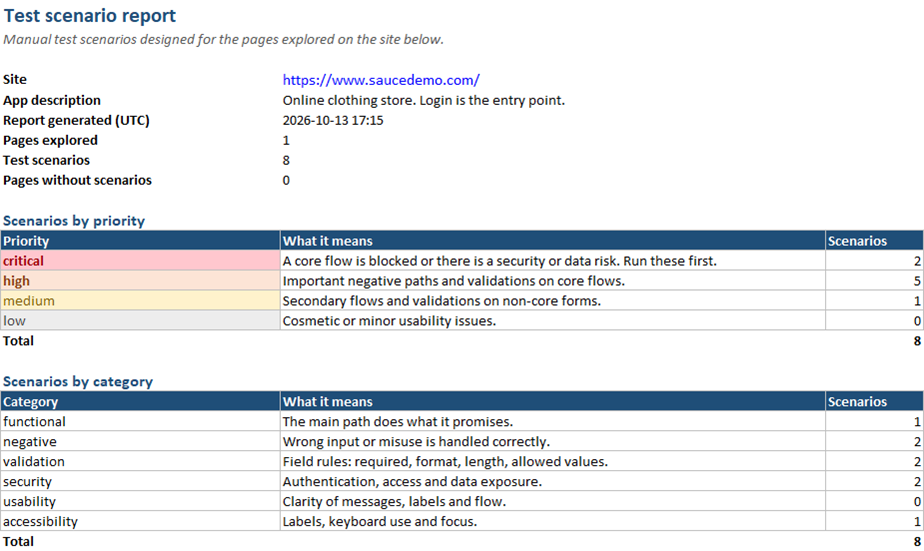
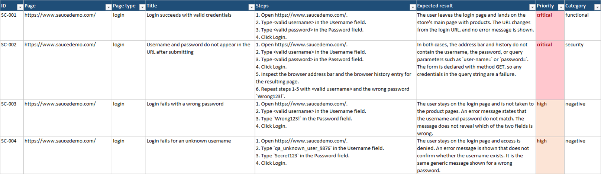
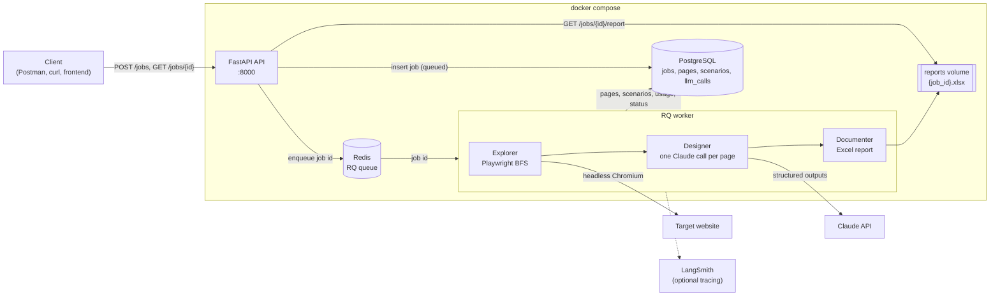
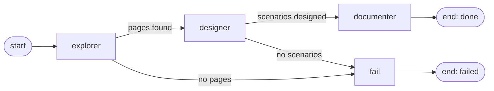
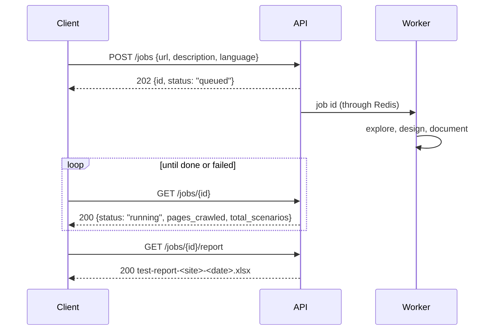

# Testing Agents

Give it a URL, and AI agents test-plan your website. A deterministic crawler maps the site with a
real browser, Claude designs test scenarios for every page, and you get an Excel report.

| Summary sheet | Scenarios sheet |
|---|---|
|  |  |

*A real report: saucedemo.com, 8 scenarios, about 20 seconds and US$0.04 of LLM spend.*

**Product:** [tests-wise.com](https://tests-wise.com) · dashboard at app.tests-wise.com

**Stack:** FastAPI · PostgreSQL 16 · Redis 7 + RQ · Playwright (Chromium) · LangGraph ·
Claude (official `anthropic` SDK, structured outputs) · openpyxl · LangSmith (optional) · uv · pytest ·
React + Vite + TypeScript + Tailwind (dashboard)

## Architecture



The API never does the heavy work: it stores the job, enqueues its id and answers `202`. The worker
runs the pipeline and writes everything to PostgreSQL. **The API and the worker share state only
through the database** ([ADR-03](docs/adr/ADR-03-async-jobs-202-polling-rq.md)).

The pipeline is a LangGraph graph. When there is nothing to work with, the graph takes the `fail`
edge instead of raising an exception:



A job seen from the client:



## Quick start (Docker)

You only need Docker Desktop and a Claude API key ([platform.claude.com](https://platform.claude.com/)).
Run the commands from the repo root.

```bash
# 1. Create the settings file (Windows cmd: copy .env.example .env)
cp .env.example .env

# 2. Edit .env and set ANTHROPIC_API_KEY=sk-ant-...
#    The other values work as they are.

# 3. Build and start everything: PostgreSQL, Redis, the API and the worker
docker compose --env-file .env -f app/docker-compose.yml up -d --build
```

The first build takes a few minutes, because the worker image includes Chromium. The services start
in order: the database and Redis first, then the API, which creates the tables, then the worker.
When `docker compose --env-file .env -f app/docker-compose.yml ps` shows every service as
`healthy`, open **http://localhost:8000/docs**.

```bash
# Logs of the worker (you will see each job going through the graph)
docker compose --env-file .env -f app/docker-compose.yml logs -f worker

# Stop everything (data stays in the volumes; add -v to delete it)
docker compose --env-file .env -f app/docker-compose.yml down
```

Without an API key the API and the crawl still work, but every job fails in the designer step.

### The dashboard

The web UI (`frontend/`) is a React single-page app: sign up, create jobs, watch them run,
browse the scenarios and download the report. It follows the **Tests Wise design system**
(warm terracotta and amber on cream, Fraunces + Figtree + JetBrains Mono, light and dark):
the tokens are CSS variables in `frontend/src/index.css`, the shared component classes live
next to them, and the public landing (`frontend/public/landing.html`, bilingual EN/ES) plus the
Terms and Privacy pages are static files that Caddy serves at `/`, `/terms` and `/privacy`.
In production everything is built into the Caddy image next to the API. For development:

```bash
cd frontend
npm install
npm run dev     # http://localhost:5173/dashboard (the API must be running on :8000); the landing is /landing.html
```

<details>
<summary><b>Running without Docker for the API and the worker (development)</b></summary>

Requires Python 3.12 and [uv](https://docs.astral.sh/uv/). PostgreSQL and Redis still run in Docker.

```bash
# From the repo root: only PostgreSQL (host port 5433) and Redis
docker compose --env-file .env -f app/docker-compose.yml up -d postgres redis

cd app                              # every Python command runs from app/
uv sync                             # install dependencies into app/.venv
uv run playwright install chromium  # once per machine
uv run alembic upgrade head         # create / migrate the tables
uv run uvicorn main:app --reload    # terminal 1: API at http://127.0.0.1:8000/docs
uv run python -m worker.worker      # terminal 2: the worker
```

Restart the worker after changing code: a running worker keeps the old code.
The full guide covers DBeaver, VS Code, LangSmith and debugging: [docs/guide.md](docs/guide.md).

</details>

## API

Every `/jobs` route needs an account: register once, send the token in every request
(`Authorization: Bearer <access_token>`), and you only see your own jobs.

```bash
curl -X POST http://localhost:8000/auth/register \
  -H "Content-Type: application/json" \
  -d '{"email": "you@example.com", "password": "a-long-password"}'
# 201 {"access_token": "eyJ...", "token_type": "bearer", "expires_in": 86400, "user": {...}}
export TOKEN=eyJ...
```

`POST /auth/login` takes the same body and returns the same token; `GET /auth/me` says who
the token belongs to. Tokens last `AUTH_TOKEN_EXPIRE_MINUTES` (default one day). Registering
sends a verification email (`EMAIL_BACKEND`: printed to the API log in development, Resend in
production); creating jobs needs the link clicked. `/auth/password/forgot` + `/auth/password/reset`
handle forgotten passwords.

The three endpoints of the main flow. The responses below are real, trimmed.

### 1. Create a job: `POST /jobs`

```bash
curl -X POST http://localhost:8000/jobs \
  -H "Authorization: Bearer $TOKEN" -H "Content-Type: application/json" \
  -d '{"url": "https://www.saucedemo.com/", "description": "Online clothing store. Login is the entry point.", "language": "en"}'
```

`description` is optional but improves the scenarios a lot: tell the agent what the app does.
`language` is `en` (default) or `es`, and sets the language of the scenarios and the report.
For a site whose content is behind a login, add `"login": {"login_url": "...", "username": "...", "password": "...", "authorized": true}`:
the explorer signs in first (use a **test account** on a **test environment**); the credentials are encrypted,
used for this job only and deleted when the exploration ends. The response only echoes `login_url`.
Each account may create `AUTH_MAX_JOBS_PER_HOUR` jobs per hour (default 20): past that, `429`. Past the
plan's monthly allowance (`GET /billing/me`), `402` with the numbers.
With `"select_pages": true` the job explores up to 20 pages and waits (`status: awaiting_selection`)
until you choose which ones get scenarios (`POST /jobs/{id}/pages/select`).

```json
202 Accepted
{
  "id": "77ac7e6a-6d8a-4a91-9cc3-095efd71764e",
  "url": "https://www.saucedemo.com/",
  "description": "Online clothing store. Login is the entry point.",
  "language": "en",
  "status": "queued",
  "pages_crawled": 0,
  "total_scenarios": 0,
  "report_path": null,
  "error": null
}
```

### 2. Follow its progress: `GET /jobs/{id}`

```bash
curl -H "Authorization: Bearer $TOKEN" http://localhost:8000/jobs/77ac7e6a-6d8a-4a91-9cc3-095efd71764e
```

`status` goes `queued` → `running` → `done` (or `failed`, with the reason in `error`). The
counters grow while the job runs, so you can poll every few seconds.

```json
200 OK
{
  "id": "77ac7e6a-6d8a-4a91-9cc3-095efd71764e",
  "status": "done",
  "pages_crawled": 1,
  "total_scenarios": 8,
  "report_path": "reports/77ac7e6a-6d8a-4a91-9cc3-095efd71764e.xlsx",
  "error": null,
  "created_at": "2026-10-13T17:14:09Z",
  "started_at": "2026-10-13T17:14:12Z",
  "finished_at": "2026-10-13T17:14:31Z"
}
```

### 3. Download the report: `GET /jobs/{id}/report`

```bash
curl -OJ -H "Authorization: Bearer $TOKEN" http://localhost:8000/jobs/77ac7e6a-6d8a-4a91-9cc3-095efd71764e/report
# saved as test-report-saucedemo.com-2026-10-13.xlsx
```

| Job status | Response |
|---|---|
| `done` | `200` with the `.xlsx` file |
| `queued` / `running` | `409` + `Retry-After` header: not ready yet, try again later |
| `failed` | `409` with the reason |
| unknown id, or another user's job | `404` |
| no / invalid token | `401` |

### Other endpoints

| Endpoint | What it returns |
|---|---|
| `POST /auth/register`, `POST /auth/login`, `GET /auth/me` | Accounts: `{email, password}` in, a token out |
| `GET /jobs` | Your jobs, newest first (paginated with `limit` / `offset`) |
| `GET /jobs/{id}/pages` | The crawled pages, with their type and element inventory |
| `GET /jobs/{id}/scenarios` | The scenarios (`SC-001`…), with steps and expected result |
| `GET /jobs/{id}/usage` | LLM calls, tokens and estimated cost of the job |
| `GET /billing/me` | Plan, jobs used this month, upgrade links |
| `POST /jobs/{id}/pages/select` | For a job created with `select_pages: true`: the pages that get scenarios; resumes the job |
| `POST /jobs/{id}/runs`, `GET /jobs/{id}/runs/{run_id}` | Pro: an AI agent executes the scenarios in a browser; verdicts with reasons and screenshots |
| `DELETE /auth/me` | Deletes the account with everything it owns (password confirmation) |
| `DELETE /jobs/{id}` | Deletes the job, its pages and scenarios |
| `GET /Health` | Health check (public) |

Every endpoint is documented and can be tried from **http://localhost:8000/docs**.

## Design decisions

Each decision is a short ADR (context → decision → consequence) in [docs/adr/](docs/adr/).

| ADR | Decision | Why |
|---|---|---|
| [01](docs/adr/ADR-01-deterministic-exploration.md) | **No LLM in the crawl**: same-domain BFS with Playwright and fixed limits | An agent that browses with tools makes dozens of calls per job and its path changes every run. The crawl costs zero tokens and is reproducible; Claude is used where it adds value. |
| [02](docs/adr/ADR-02-designer-model.md) | **Claude Opus 5.5, effort `high`, for the Designer** (provisional) | The scenarios are the product. About US$0.04 per page; the eval script (`agents.designer_eval`) compares models and prompt versions before the choice is closed. |
| [03](docs/adr/ADR-03-async-jobs-202-polling-rq.md) | **`202` + polling, with an RQ worker** | A job takes from seconds to minutes, too long for one HTTP request. RQ is simpler than Celery and, unlike `BackgroundTasks`, survives API restarts. Only the job id goes through Redis. |
| [04](docs/adr/ADR-04-heuristic-page-classification.md) | **Page types (login, product, checkout…) by heuristic rules** | The signals are already in the inventory. Rules cost nothing, are instant and are unit-tested; every misclassified real page becomes a test. |
| [05](docs/adr/ADR-05-langgraph-and-official-sdk.md) | **LangGraph for the pipeline, the official Anthropic SDK with structured outputs** | An explicit graph with `fail` edges, testable node by node. The JSON schema guarantees the shape of the output, and a single self-healing retry fixes what the schema cannot check. |
| [06](docs/adr/ADR-06-llm-cost-ledger.md) | **One `llm_calls` row per billed call** | Retries, refusals and fallbacks are billed too. With a ledger, the cost of a job is a `SUM`, and the price of the SaaS can be based on real numbers. |
| [07](docs/adr/ADR-07-jwt-auth-and-job-ownership.md) | **Email + password accounts, JWT tokens, jobs owned per user** | Every job costs money, so the API cannot be open. Stateless tokens keep the API horizontal; an hourly job limit caps the damage of a leaked token. |
| [09](docs/adr/ADR-09-billing-merchant-of-record.md) | **Billing through Stripe (Checkout + Customer Portal); plans are monthly job allowances** | Hosted checkout, so no card data on our side. Our side is one `subscriptions` row per user written only by signed webhooks, and a `402` at `POST /jobs` past the allowance. Taxes stay ours (Stripe Tax optional). |
| [10](docs/adr/ADR-10-executor-agent.md) | **The Executor runs scenarios in a real browser with tools, not an MCP server** | Running the tests needs judgement, so a model drives Playwright through six tools on the worker's own browser. Guardrails live in the tools (same host, no paying/deleting, step and time caps); test environments only; Pro plan, 10 runs/month, Sonnet. |
| [08](docs/adr/ADR-08-authenticated-crawls.md) | **Sites behind a login: credentials per job, encrypted, deleted after the crawl** | Most products live behind a login. The secret lives minutes, never reaches the state, the logs or the LLM; the crawler skips action links while logged in; the customer uses a test account and confirms authorization. |

## Deployment

One VPS, the same compose plus a production overlay (Caddy for HTTPS, no published database
ports, Redis password, SQL logs off):

```bash
docker compose --env-file .env -f app/docker-compose.yml -f app/docker-compose.prod.yml up -d --build
```

The full procedure (server, DNS, `.env` keys, backups, updates, checklist) is in
[docs/deployment.md](docs/deployment.md).

## Tests

```bash
cd app
uv run pytest                    # unit tests: no database, no Docker, no internet, no API key
uv run pytest -m integration -v  # end to end: real PostgreSQL and Redis, a real worker, a local site
```

No test calls the Claude API: the LLM is replaced at three levels (HTTP transport, SDK client and
designer function). The integration test starts its own worker on its own queue and checks the full
flow, from `POST /jobs` to the downloaded Excel file. Details in the
[guide](docs/guide.md#integration-test-wta-24).

## Roadmap

**Product**
- **Dashboard** (done, `frontend/`): next, scenario editing, re-running a job and sharing a report by link.
- **Executor v2**: verdict review by a second model, retries of flaky steps, scenarios about payments on sandbox accounts.
- **Testing RAG**: a knowledge base of testing practices and of earlier scenarios, retrieved by
  page type, so the Designer writes better and more consistent scenarios.
- **MCP server**: expose "test this site" as tools, so Claude, an IDE or another agent can start a
  job and read its scenarios.
- **CLI**: `testing-agents run https://...` for local use and CI pipelines.

**Engine**
- Automatic retries of failed jobs (WTA-8).
- Close ADR-02 with the eval on real sites, and prompt v4 based on its results.
- Team accounts, metered overages, a nightly reconciliation with the payment provider.

## Documentation

- [docs/guide.md](docs/guide.md): the full technical guide (data model, every command,
  configuration, the Excel report, languages, tracing, costs, debugging, conventions).
- [docs/deployment.md](docs/deployment.md): running it on a server with HTTPS.
- [frontend/README.md](frontend/README.md): the dashboard's structure and commands.
- [docs/adr/](docs/adr/): the design decisions.
- [CLAUDE.md](CLAUDE.md): architecture notes and conventions for AI-assisted development.
- Work plan (Notion, in Spanish):
  [Tablero · SaaS Web Testing Agents — Paso 1 (Motor MVP)](https://app.notion.com/p/7b50aed7e8c34d909f606ed3c49f1642).
