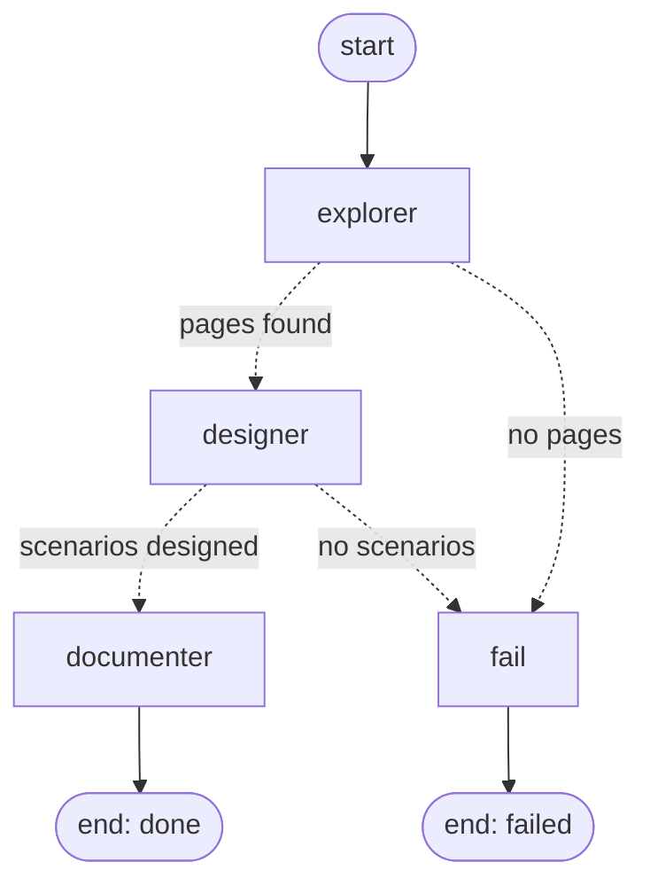

# Testing Agents

Agent-assisted web testing SaaS. It takes a site's URL, crawls it, generates test scenarios
with an LLM and delivers a report. This repository contains **Step 1 (MVP Engine)**: API,
database, queue and worker.

The work plan lives in Notion:
[Tablero · SaaS Web Testing Agents — Paso 1 (Motor MVP)](https://app.notion.com/p/7b50aed7e8c34d909f606ed3c49f1642).

## Current status

| Block | Task | Status |
|---|---|---|
| A — Skeleton | Repository and folder structure | Done |
| A — Skeleton | Postgres and Redis with docker-compose | Done |
| A — Skeleton | FastAPI API: `POST /jobs` and `GET /jobs/{id}` | Done |
| A — Skeleton | SQLAlchemy models + CRUD + Alembic migrations | Done |
| A — Skeleton | Anti-SSRF URL validation | Done |
| B — Queue and Worker | Enqueue jobs with RQ, worker | Done |
| B — Queue and Worker | Failure handling (failed state, retry) | Pending |
| C — Explorer | Worker Dockerfile with Playwright + Chromium | Done |
| C — Explorer | Same-domain BFS crawler with page limit and robots.txt (WTA-10) | Done |
| C — Explorer | Element extraction per page: forms, buttons, navigation (WTA-11) | Done |
| C — Explorer | Full-page screenshots per page (WTA-12) | Done |
| C — Explorer | Heuristic `page_type` classification (WTA-13) | Done |
| C — Explorer | Persist pages one by one, live progress in `GET /jobs/{id}` (WTA-14) | Done |
| D — Designer | Designer prompt + structured output with Pydantic (WTA-15) | Done (not yet wired into the worker) |
| D — Designer | Parse retry, LLM error handling and model choice (WTA-16) | Done; model comparison pending a real API key ([ADR-02](adr/ADR-02-designer-model.md)) |
| D — Designer | Designer wired into the worker, scenarios persisted in Postgres (WTA-17) | Done |
| D — Designer | Token and cost logging per job: `llm_calls` table, `GET /jobs/{id}/usage` (WTA-18) | Done |
| E — Documenter | Excel report per job with openpyxl, `reports/{job_id}.xlsx` (WTA-19) | Done |
| E — Documenter | `GET /jobs/{id}/report` to download the Excel (WTA-20) | Done |
| E — Graph | Worker runs the job as a LangGraph `StateGraph` (WTA-21) | Done |
| D to F | Designer, Documenter, Quality | Pending |

## Architecture

```
client ──POST /jobs──▶ API (FastAPI) ──▶ PostgreSQL ◀── worker (RQ) runs the LangGraph pipeline
            ◀──202────┘    │  ▲                          ▲
client ──GET /jobs/{id}────┘  │                          │
client ──GET /jobs/{id}/report┘   Redis (queue) ─────────┘
```

Async job pattern: `POST /jobs` only stores the job in `queued` state, enqueues its id in
Redis and responds `202`. The worker, a separate process, takes the id and runs the job
through a LangGraph graph: crawl, LLM, report. The client polls progress with
`GET /jobs/{id}` and downloads the Excel when the job is `done`. API and worker share state
**through the database**, never in memory.

### The job pipeline (LangGraph, WTA-21)



`agents/graph.py` builds a `StateGraph` over `TestingState` (`agents/state.py`), and the
worker calls `graph.invoke(initial_state)`. Dotted arrows are conditional edges: "nothing to
work with" is a normal path of the graph that ends in `failed`, not an exception.
Exceptions are kept for real errors (the browser crashed, the API key is invalid, the
database is down), and the worker catches those. Each node reads only the keys it needs and
returns only the keys it owns:

| Node | Reads | Writes | Side effects |
|---|---|---|---|
| `explorer` | `job_id`, `url` | `pages` | crawls the site, saves each page as it is found |
| `designer` | `job_id`, `description`, `pages` | `scenarios_designed`, `pages_without_scenarios` | one Claude call per page, saves the scenarios and every LLM call |
| `documenter` | `job_id`, `pages`, `pages_without_scenarios` | `report_path`, `status`, `error` | writes the Excel, marks the job `done` |
| `fail` | `pages`, `scenarios_designed`, `pages_without_scenarios` | `status`, `error` | marks the job `failed` with the reason |

**What is in the state at each transition** (a real one-page job on a login page):

1. **Input**, from the worker: `{job_id, url: "https://www.saucedemo.com/", description}`.
2. **After `explorer`**: plus `pages: [{page_id: 28, url, title: "Swag Labs", page_type:
   "login", elements: {forms: [...]}}]`. `route_after_explorer` sees one page and goes to
   `designer`. With `pages: []` it would go to `fail`.
3. **After `designer`**: plus `scenarios_designed: 10, pages_without_scenarios: []`. The
   scenarios themselves are already in Postgres; the state only carries the count.
   `route_after_designer` sees 10 and goes to `documenter`.
4. **After `documenter`**: plus `report_path: "reports/<job_id>.xlsx", status: "done",
   error: null`. That is the final state `invoke` returns to the worker.

On the failure path, `https://httpbin.org/status/404` gives `pages: []` after the
explorer, then `fail` adds `status: "failed", error: "No page could be fetched from the
given URL."`. The designer is never called, so the LLM is never paid for.

The state holds only plain data (ids, strings, dicts), never ORM objects, sessions or the
browser. It stays small and loggable, and a LangGraph checkpointer could persist it later
without changes. To watch the transitions yourself, use
`graph.testing_graph.stream(initial_state, stream_mode="updates")`: it yields one
`{node: what_it_wrote}` per step.

### Data model

```
job (uuid) ──1:N──▶ pages (serial) ──1:N──▶ scenarios (serial)
```

| Table | Key fields |
|---|---|
| `users` | `id` UUID, `email` (unique, lower-case), `password_hash` (argon2id), `is_active`, `created_at` |
| `job` | `id` UUID, `user_id` (owner, NULL only for pre-WTA-26 rows), `url`, `status` (`queued` / `running` / `done` / `failed`), `pages_crawled`, `total_scenarios`, `report_path`, `error`, `created_at`, `started_at`, `finished_at` |
| `pages` | `job_id`, `url`, `title`, `page_type`, `screenshot_path`, `elements` (JSONB `PageInfo` inventory: forms with fields, buttons, nav links, headings) |
| `scenarios` | `job_id`, `page_id`, `scenario_code` (`SC-001`…, unique per job), `title`, `steps` (JSONB), `expected_result`, `priority`, `category` |

Deleting a job cascades to its pages and scenarios.

## Repository structure

```
TestingAgents/
├── .env                  # local variables (NOT versioned)
├── frontend/             # React dashboard (Vite + TypeScript + Tailwind); see frontend/README.md
├── .env.example          # variables template
├── pyrightconfig.json    # points Pylance to the app/ venv
├── .vscode/settings.json # VS Code interpreter
├── FE/                   # frontend (empty for now)
└── app/                  # Python backend (uv project)
    ├── pyproject.toml / uv.lock
    ├── docker-compose.yml   # Postgres 16 + Redis 7 + api + worker
    ├── docker-compose.prod.yml  # production overlay: Caddy/HTTPS, no public DB ports (docs/deployment.md)
    ├── deploy/              # Caddyfile, backup.sh
    ├── Dockerfile           # targets `api` and `worker` (worker adds Chromium)
    ├── main.py              # FastAPI app, CORS, /Health
    ├── config/variables.py  # Settings (pydantic-settings) read from .env
    ├── db/
    │   ├── conn.py          # engine, session, Base, get_db dependency
    │   ├── models_db/models_db.py  # Job, Page, Scenario tables
    │   ├── db_crud.py       # database operations
    │   └── init_db.py       # creates the tables and stamps alembic head (development shortcut)
    ├── alembic/             # migrations (WTA-4): versions/0001..., env.py reads .env
    ├── services/mailer.py   # verification / reset emails: console or Resend (WTA-28)
    ├── models/models.py     # Pydantic input/output schemas
    ├── routes/routes.py     # /jobs endpoints (every one needs a token)
    ├── routes/auth_routes.py # /auth/register, /auth/login, /auth/me (WTA-26)
    ├── security/auth.py     # password hashing, JWT, get_current_user
    ├── security/ssrf.py     # anti-SSRF validation of the job URL
    ├── db/redis/redis_conn.py  # Redis client, RQ queue, enqueue helper
    ├── worker/
    │   ├── worker.py        # starts the RQ worker
    │   ├── tasks.py         # what runs for each job (queued → running → done/failed)
    │   └── check_browser.py # Playwright smoke test
    ├── agents/  tests/      # pending
    └── .venv/               # created by uv (NOT versioned)
```

## Requirements

- [Docker Desktop](https://www.docker.com/products/docker-desktop/)
- [uv](https://docs.astral.sh/uv/) (manages Python and dependencies; installs Python 3.12 by itself)
- Optional: [DBeaver](https://dbeaver.io/) to browse the database

## Getting started

### 1. Environment variables

```powershell
copy .env.example .env
```

| Variable | Description | Default |
|---|---|---|
| `DB_USER` | PostgreSQL user | `myuser` |
| `DB_PASSWORD` | PostgreSQL password | `password` |
| `DB_NAME` | database | `local` |
| `DB_PORT` | port exposed on your machine | `5433` |
| `ENDPOINT` | PostgreSQL host as seen from the API | `localhost` |
| `REDIS_PORT` | exposed Redis port | `6379` |
| `AUTH_SECRET_KEY` | signs the login tokens (WTA-26). **Required by the API**; generate it with `python -c "import secrets; print(secrets.token_urlsafe(48))"`. Changing it logs everyone out | placeholder (the API warns) |
| `AUTH_TOKEN_EXPIRE_MINUTES` | token lifetime | `1440` (one day) |
| `AUTH_MAX_JOBS_PER_HOUR` | jobs one account may create per rolling hour; `429` past it | `20` |
| `AUTH_VERIFY_TOKEN_HOURS`, `AUTH_RESET_TOKEN_MINUTES` | lifetime of the links sent by email | `48`, `60` |
| `EMAIL_BACKEND` | `console` (print to the API log) or `resend` | `console` |
| `RESEND_API_KEY`, `EMAIL_FROM` | Resend key and verified sender (`Name <no-reply@yourdomain.com>`) | unset |
| `APP_URL` | public URL of the dashboard, used in the email links | `http://localhost:5173` |
| `CORS_ORIGINS` | JSON list of browser origins allowed by CORS | `["*"]` |
| `JOB_TIMEOUT_SECONDS`, `JOB_MAX_RETRIES` | hard limit per attempt and automatic retries of a job that raises (WTA-8) | `900`, `1` |
| `RATE_LIMIT_ENABLED` | limits on login / register / reset endpoints, counted in Redis | `true` |
| `PWNED_PASSWORDS_CHECK` | reject passwords found in known breaches (Have I Been Pwned, k-anonymity) | `true` |
| `SENTRY_DSN`, `SENTRY_ENVIRONMENT` | error reporting; empty = off | unset, `development` |
| `RETENTION_DAYS` | finished jobs older than this are deleted by the worker; `0` keeps everything | `90` |
| `DEFAULT_PLAN` | plan of accounts without a subscription (`free`, `starter`, `pro`) | `free` |
| `LEMONSQUEEZY_*` | webhook secret, variant ids and checkout URLs; see [deployment.md](deployment.md) | unset |
| `EXECUTOR_MODEL`, `EXECUTOR_EFFORT` | the model that runs scenarios (WTA-33) | `claude-sonnet-5-5`, `medium` |
| `EXECUTOR_MAX_STEPS`, `EXECUTOR_SCENARIO_TIMEOUT`, `EXECUTOR_MAX_SCENARIOS`, `RUN_TIMEOUT_SECONDS` | caps of a run | `20`, `120`, `25`, `3600` |
| `DISCOVERY_MAX_PAGES` | pages explored when the user will choose them (`select_pages`), no LLM cost | `20` |
| `CREDENTIALS_KEY` | Fernet key for the per-job login credentials (WTA-29); without it, jobs with a login get `503` | unset |
| `SQL_ECHO` | print every SQL statement to the console | `true` (production: `false`) |
| `REDIS_PASSWORD`, `DOMAIN` | production only, see [deployment.md](deployment.md) | unset |

`DB_PORT` is `5433` rather than `5432` on purpose: if you have PostgreSQL installed on
Windows, it takes 5432 and DBeaver or the API would connect to it instead of the container
(symptom: `password authentication failed for user "myuser"`).

The user and password are set **the first time** the Postgres volume is created. If you
change them later, you have to recreate it: `docker compose ... down -v` (deletes the data).

### 2. Database and Redis

From the repository root:

```powershell
docker compose --env-file .env -f app/docker-compose.yml up -d
docker ps        # postgres_db and redis_cache should be "Up"
```

`--env-file .env` is required because the compose file is in `app/` and `.env` is at the root.

### 3. Python dependencies

```powershell
cd app
uv sync
```

Creates `app/.venv` with Python 3.12 and everything in `uv.lock`. No need to activate the
environment: `uv run <command>` uses it automatically.

### 4. Create the tables

```powershell
uv run alembic upgrade head
```

Applies every migration in `app/alembic/versions/` that the database has not seen yet
(WTA-4). Run it again after pulling code that adds a migration. `uv run python -m db.init_db`
still works as a shortcut (creates the tables and stamps the latest revision), but
`upgrade head` is the one that also alters existing tables.

**Databases created before migrations existed** (with `init_db` only): tell Alembic where they
are, once, then upgrade. A database from before accounts (WTA-26) is at `0001`; one with the
`users` table and `job.user_id` is at `0002`:

```powershell
uv run alembic stamp 0002_users_and_job_owner   # or 0001_initial_schema
uv run alembic upgrade head
uv run alembic check                            # "No new upgrade operations detected" = in sync
```

Changing a model: `uv run alembic revision --autogenerate -m "short description"`, then read
the generated file (autogenerate misses data migrations and some type changes), then
`upgrade head`. Migration files are named `NNNN_slug.py` and are never edited once merged.

### 5. Run the API

```powershell
uv run uvicorn main:app --reload
```

- Swagger: http://127.0.0.1:8000/docs
- Health: http://127.0.0.1:8000/Health

### 6. Run the worker

In another terminal, also from `app/`:

```powershell
uv run python -m worker.worker
```

It picks up the jobs enqueued by `POST /jobs` one at a time and runs `worker/tasks.py`
(`queued` → `running` → `done`/`failed`). Without a worker
running, jobs stay `queued`.

### Alternative: everything in Docker

Instead of steps 3–6, build and run API and worker as containers next to Postgres and Redis.
From the repository root:

```powershell
docker compose --env-file .env -f app/docker-compose.yml up -d --build   # the api creates the tables on start
docker compose --env-file .env -f app/docker-compose.yml ps                         # wait until every service is healthy
docker compose --env-file .env -f app/docker-compose.yml exec worker python -m worker.check_browser  # Playwright opens example.com
docker compose --env-file .env -f app/docker-compose.yml logs -f worker                         # watch jobs being processed
```

The services start in order through healthchecks: Postgres and Redis, then the api (which runs
`alembic upgrade head` before uvicorn, so a fresh database gets its tables and an existing one
its pending changes), then the worker.

For a real server (HTTPS, no published database ports, backups) see [deployment.md](deployment.md).

`app/Dockerfile` has two targets from the same base: `api` (slim) and `worker` (adds Chromium
only, via `playwright install --with-deps chromium`). To run the worker or the Playwright
tests **outside** Docker, download the same browser once: `uv run playwright install chromium`
(from `app/`; the build must match the Playwright version in `uv.lock`, so rerun it after
`uv sync` upgrades Playwright).

Inside the Docker network the compose
file overrides `ENDPOINT=postgres`, `REDIS_HOST=redis` and `DB_PORT=5432`; your `.env` keeps
the `localhost` values for running outside Docker.

## API usage

Every `/jobs` route requires a logged-in user (WTA-26): register or log in, then send
`Authorization: Bearer <access_token>` on each request. Without it the answer is `401` with
`WWW-Authenticate: Bearer`. Jobs belong to the account that created them: another user's job
answers `404`, exactly like a job that does not exist. In Swagger (`/docs`), the **Authorize**
button takes the token.

| Method | Path | Response |
|---|---|---|
| `POST` | `/auth/register` | body `{"email", "password"}` (8+ characters); `201` with `{access_token, token_type, expires_in, user}`; `409` if the email is taken; `422` if the email is malformed or the password too short |
| `POST` | `/auth/login` | same body; `200` with the same token shape; `401` "Wrong email or password" (never says which) |
| `GET` | `/auth/me` | the account behind the token |
| `POST` | `/jobs` | body `{"url", "description"?, "language"?: "en" \| "es", "login"?: {"login_url"?, "username", "password", "authorized": true}}`; `202` with the created job; `400` if the URL is not http/https, does not resolve, or points to an internal network (anti-SSRF); `422` for an unsupported language; `429` + `Retry-After` past `AUTH_MAX_JOBS_PER_HOUR` |
| `GET` | `/jobs` | the caller's jobs (newest first), optional `limit` and `offset` |
| `GET` | `/jobs/{id}` | the job; `404` if it does not exist; `422` if the id is not a UUID |
| `GET` | `/jobs/{id}/pages` | pages crawled for the job |
| `GET` | `/jobs/{id}/scenarios` | scenarios generated for the job |
| `GET` | `/jobs/{id}/usage` | LLM tokens and estimated USD the job has spent |
| `GET` | `/jobs/{id}/report` | `200` the Excel report as a download (`test-report-{domain}-{date}.xlsx`); `409` while the job runs or if it failed; `404` if the job does not exist |
| `DELETE` | `/jobs/{id}` | `204`; also deletes pages and scenarios |

```powershell
# register (or log in) and keep the token
$auth = Invoke-RestMethod -Method Post http://127.0.0.1:8000/auth/register `
  -ContentType "application/json" -Body '{"email": "you@example.com", "password": "a-long-password"}'
$headers = @{ Authorization = "Bearer $($auth.access_token)" }

# create a job
$job = Invoke-RestMethod -Method Post http://127.0.0.1:8000/jobs -Headers $headers `
  -ContentType "application/json" -Body '{"url": "https://example.com", "language": "es"}'

# fetch it (poll until status is "done")
Invoke-RestMethod "http://127.0.0.1:8000/jobs/$($job.id)" -Headers $headers

# download the Excel report
Invoke-WebRequest "http://127.0.0.1:8000/jobs/$($job.id)/report" -Headers $headers -OutFile report.xlsx
```

Passwords are stored as argon2id hashes; tokens are HS256 JWTs signed with
`AUTH_SECRET_KEY`, with the user id and an expiry, and no server-side session. The design is
[ADR-07](adr/ADR-07-jwt-auth-and-job-ownership.md); the code is `security/auth.py` and
`routes/auth_routes.py`; `tests/test_auth.py` covers it.

Databases created before WTA-26 get the `users` table and `job.user_id` from migration
`0002` (see "Create the tables"). Jobs from before accounts existed keep `user_id = NULL` and
are not visible through the API.

### Email verification and password reset (WTA-28)

| Method | Path | Response |
|---|---|---|
| `POST` | `/auth/verify/request` | (token) sends the verification email again; `202` |
| `POST` | `/auth/verify` | body `{"token"}` from the link; `200` with the user, `400` if unknown, used or expired |
| `POST` | `/auth/password/forgot` | body `{"email"}`; always `202` with the same message, mail only if the account exists |
| `POST` | `/auth/password/reset` | body `{"token", "password"}`; `200` with a fresh token (logs in), `400` for a bad link |

Registering sends a verification link (`APP_URL/verify?token=...`, valid `AUTH_VERIFY_TOKEN_HOURS`).
An unverified account can log in and browse, but `POST /jobs` answers `403` until the link is
clicked: jobs spend money. Reset links (`APP_URL/reset-password?token=...`) last
`AUTH_RESET_TOKEN_MINUTES`; a reset bumps `users.token_version`, which every JWT carries, so
all earlier sessions are logged out, and it also marks the email verified (whoever reads the
mailbox owns the address). Tokens are stored hashed in `email_tokens` and are single-use;
asking for a new one invalidates the previous. `services/mailer.py` sends through
`EMAIL_BACKEND`: `console` (printed to the API log; take the token from there in development)
or `resend`. Emails go out in FastAPI background tasks, so a provider outage is logged and the
user can ask again instead of getting a 500. `tests/test_email.py` covers it; API tests get a
verified account from `tests.conftest.sign_in`, which captures the email and clicks its link.

### Choosing the pages before spending (WTA-32)

`POST /jobs` with `"select_pages": true` explores up to `DISCOVERY_MAX_PAGES` (20) pages and
then **pauses**: the graph's `pause` node sets the status `awaiting_selection` (and clears
any login credentials). `GET /jobs/{id}/pages` lists what was found, every page `selected`
by default. `POST /jobs/{id}/pages/select` with `{"page_ids": [...]}` keeps those pages,
sets the job back to `queued` and enqueues `worker.tasks.continue_job_task`, which runs
`continuation_graph` (designer -> documenter / fail) on the selected pages only; unselected
pages stay in the job, get no scenarios and are left out of the report. While waiting, the
report endpoint answers `409` with `status: awaiting_selection`; the dashboard shows
checkboxes and a "Generate scenarios for N pages" button. Tests:
`tests/test_page_selection.py`.

### Automated test runs (WTA-33)

`POST /jobs/{id}/runs` with `{"test_environment": true, "login"?: {...}}` (Pro plan,
`Plan.test_runs_per_month`, `402` past it; the job must be `done`; one run at a time)
creates a `test_runs` row and enqueues `worker.tasks.run_tests_task`. The worker
(`worker/run_tests.py`) opens one Chromium, logs in if credentials were given (ADR-08 rules),
and for each scenario of the selected pages (at most `EXECUTOR_MAX_SCENARIOS`) calls
`agents.executor.execute_scenario`: a Messages API tool-use loop on `EXECUTOR_MODEL`
(Sonnet) with the tools `navigate`, `read_page`, `click`, `fill`, `press`, `finish`, bound to
the job's host. Verdicts (`pass` / `fail` / `blocked`, a reason, the step log, a final
screenshot) go to `scenario_results` one commit at a time, the run's counters move with
them, every model call is an `llm_calls` row with `agent = executor`, and the Excel gets a
third sheet, Results. `GET /jobs/{id}/runs`, `GET /jobs/{id}/runs/{run_id}` (with results)
and `.../results/{result_id}/screenshot`. Guardrails: forbidden words (pay, purchase,
delete, cancel...) are refused by the tools themselves; `EXECUTOR_MAX_STEPS` and
`EXECUTOR_SCENARIO_TIMEOUT` turn a stuck scenario into `blocked`; `RUN_TIMEOUT_SECONDS`
bounds the whole run. In `DESIGNER_MODE=fake` the Executor passes any page that loads.
Design: [ADR-10](adr/ADR-10-executor-agent.md); tests: `tests/test_executor.py`.

### Sites behind a login (WTA-29)

`POST /jobs` accepts an optional `login` object: `login_url` (defaults to the job URL),
`username`, `password` and `authorized: true` (the customer confirms they may test that site
with that account). The explorer opens the login page in Chromium, finds the visible
password field, the text/email field before it and the form's submit, signs in, and crawls
with that session. A visible password field after submitting means the login failed: the
crawl continues anonymously and `job.error` says so. While logged in, links whose path
contains an action word (`logout`, `delete`, `checkout`, `pay`, `cancel`, ...,
`UNSAFE_LINK_WORDS` in `agents/explorer.py`) are not followed: the crawler acts as a real user.

The credentials are encrypted with `CREDENTIALS_KEY` (`security/credentials.py`, Fernet)
before the row is written, decrypted only inside the explorer node, and cleared from
`job.login_credentials` in a `finally` right after the crawl; `mark_job_done`,
`mark_job_failed` and a worker start-up sweep clear them again. They never enter the graph
state, the API responses (only `login_url` is shown), the report or the LLM prompt. The
login page must pass the anti-SSRF check and be on the same host as the job URL. Design:
[ADR-08](adr/ADR-08-authenticated-crawls.md); tests: `tests/test_login_crawl.py` (a local
site with a cookie session, crawled in Chromium).

Not supported: 2FA, captchas, social login. Ask the customer for a test account without them.

### Plans and billing (WTA-30)

Plans are monthly job allowances (`config/plans.py`: Free 3, Starter 10 for US$19, Pro 40 for US$49). `GET
/billing/me` returns the plan in force, the jobs used this calendar month, the remaining
allowance, the provider's status, and the hosted checkout links (with the user's email and
id prefilled). `POST /jobs` answers `402` with `{message, plan, used, limit}` past the
allowance. Payments go through Lemon Squeezy (a Merchant of Record, [ADR-09](adr/ADR-09-billing-merchant-of-record.md)):
`POST /billing/webhook/lemonsqueezy` verifies the `X-Signature` HMAC on the raw body and
upserts the user's `subscriptions` row (`services/billing.py`). Statuses `active`,
`on_trial` and `past_due` keep the plan; `cancelled` keeps it until `current_period_end`;
anything else falls back to `DEFAULT_PLAN`. Tests: `tests/test_billing_and_retention.py`.

### Account deletion and retention (WTA-30)

`DELETE /auth/me` with `{"password"}` deletes the user with every job (pages, scenarios,
LLM calls), its tokens, its subscription row and the files under `reports/`
(`services/cleanup.py`). The worker deletes finished jobs older than `RETENTION_DAYS` with
their files, at start and every 6 hours (`purge_expired_jobs`). Deleting a job through the
API removes its files too.

### Abuse protection (WTA-30)

`security/ratelimit.py`: fixed-window counters in Redis (`MemoryBackend` in tests), per IP
and per email/user, on login (20/15 min per IP, 10 per email), register (10/h per IP),
forgot-password (20/h per IP, 5/h per email), token endpoints (30/h per IP) and
verification resends (5/h per user). A `429` carries `Retry-After`. The limiter fails open
when Redis is down. Behind Caddy, uvicorn runs with `--proxy-headers` so the client IP is
the real one. `security/passwords.py` rejects passwords found in breaches (HIBP range API,
only the first 5 hex of the SHA-1 leave the server; fails open).

### Reliability (WTA-8)

Jobs are enqueued with `job_timeout=JOB_TIMEOUT_SECONDS` and `Retry(max=JOB_MAX_RETRIES)`
(`db/redis/redis_conn.py`). A task that raises marks the job `failed` with the reason and,
while retries remain, "Retrying automatically (N attempts left)"; RQ re-enqueues it and
`mark_job_running` wipes the previous attempt. A timeout reads "exceeded the time limit of
15 minutes". Sentry (`observability.py`) reports exceptions from the API and the worker when
`SENTRY_DSN` is set, without personal data.

## Querying the scenarios (WTA-17)

After the crawl, the worker sends each page to the Designer and stores its scenarios in
`scenarios`, one short transaction per page, so `total_scenarios` grows live like
`pages_crawled`. Codes `SC-001`, `SC-002`... continue across the job's pages and are unique
per job (constraint `uq_scenario_code_per_job`). A page the Designer cannot cover is skipped:
the job still ends `done`, and `job.error` lists the uncovered pages. If no page gets
scenarios, or the configuration is wrong (bad API key, unknown model), the job ends `failed`.

`priority` and `category` are plain columns because they are what you filter and group by.
`steps` is JSONB because it is an ordered list, always read whole with its scenario, and its
length varies per scenario. The scenarios also come back from `GET /jobs/{id}/scenarios`.

```sql
-- the counter matches the rows, and the codes are unique
SELECT j.total_scenarios, count(s.id) AS rows, count(DISTINCT s.scenario_code) AS unique_codes
FROM job j LEFT JOIN scenarios s ON s.job_id = j.id
WHERE j.id = '<job_id>' GROUP BY j.total_scenarios;

-- by page
SELECT p.url, p.page_type, count(s.id) AS scenarios
FROM pages p JOIN scenarios s ON s.page_id = p.id
WHERE p.job_id = '<job_id>' GROUP BY p.url, p.page_type;

-- by priority / by category
SELECT priority, count(*) FROM scenarios WHERE job_id = '<job_id>' GROUP BY priority;
SELECT category, count(*) FROM scenarios WHERE job_id = '<job_id>' GROUP BY category;

-- the steps of one scenario, one row per step (JSONB)
SELECT jsonb_array_elements_text(steps) AS step
FROM scenarios WHERE job_id = '<job_id>' AND scenario_code = 'SC-001';
```

## Excel report (WTA-19)

After the Designer, the worker writes `reports/{job_id}.xlsx` with `agents/documenter.py`,
stores the path in `job.report_path`, and only then marks the job `done`, so a finished job
always has its report. The report is built from what is in the database, and every total
is computed from the same rows as the Scenarios sheet, so the two cannot disagree.

- **Summary**: site, app description, generation date, pages explored, scenarios, and pages
  left without scenarios. It has totals by priority and by category, each with one line on
  what it means; a table of the pages with their type and number of scenarios; and a short
  "How to use this report" for readers who know nothing about the project.
- **Scenarios**: one row per scenario: ID, page, page type, title, steps (numbered, one per
  line), expected result, priority (color-coded), category. Empty **Result** (a drop-down
  with Not run, Pass, Fail, Blocked) and **Notes** columns are left for whoever runs the
  tests. The header row and the ID column stay frozen, filters are on, and row heights are
  set to fit the text.
- Page titles and LLM output are untrusted. Characters that would make Excel refuse the
  file are stripped, and a value starting with `=` is stored as text, never as a formula.
  The file is written to a temporary name and then renamed, so a download never sees a
  half-written report.

Generate the report of an existing job by hand (no API calls), from `app/`:

```powershell
uv run python -c "import uuid; from db.conn import local_session; from agents.documenter import generate_report; db = local_session(); print(generate_report(db, uuid.UUID('<job_id>'), 'reports'))"
```

Verified with a real job: Excel 16 opens the file with no repair prompt.

### Downloading it (WTA-20)

`GET /jobs/{id}/report` returns the file with
`Content-Type: application/vnd.openxmlformats-officedocument.spreadsheetml.sheet` and
`Content-Disposition: attachment; filename="test-report-{domain}-{yyyy-mm-dd}.xlsx"`. The
domain drops `www.` and the date is when the job finished. A browser saves it directly.

| Situation | Response | Why |
|---|---|---|
| Job `done` | `200` with the file | |
| Job `queued` or `running` | `409 Conflict` + `Retry-After: 15`, detail `{"status": "running", "message": "...N pages explored, M scenarios so far..."}` | The job exists, but its current state does not allow the request. A `404` would tell a polling client the id is wrong and make it give up. |
| Job `failed` | `409 Conflict`, detail `{"status": "failed", "message": "...Reason: <job.error>"}` | Same resource and state logic. There is no `Retry-After`, because this job will never have a report. |
| No such job | `404 Not Found` | The only case where the resource does not exist. |

Clients can branch on `detail.status`. The file path is derived from the job id, never
read from the database, so a stored value cannot point the endpoint at another file. A
`done` job whose file is missing gets its report rebuilt from the database on the spot,
without calling the LLM. That covers jobs finished before reports existed, and deleted files.

## Languages: English and Spanish

Each job is delivered in the language chosen when it is created: `"language": "en"` (the
default) or `"es"` in `POST /jobs`. It is stored in `job.language` and decides:

- **The scenarios.** Titles, steps and expected results are written in that language.
  Since prompt v3 the language is an explicit instruction (`<output_language>` in the
  Designer's user message), not guessed from the description: a Spanish description with
  `"language": "en"` still gets English scenarios. Labels, buttons and messages are quoted
  exactly as the page shows them, so a tester can find them on screen.
- **The report.** Sheet names (`Summary`/`Resumen`, `Scenarios`/`Escenarios`), headers,
  explanations, the "how to use" section, the Result drop-down and the file name
  (`test-report-…` / `reporte-pruebas-…`) follow the language.

Priority, category and page type are stored and returned by the API as English codes
(`critical`, `security`, `login`) in every language, so filters and SQL never depend on the
language. Only the report translates them for people (`crítica`, `seguridad`, `inicio de
sesión`). All report texts live in `agents/report_texts.py`. Adding a language means:

1. Add it to `Language` and `LANGUAGE_NAMES` in `config/languages.py`.
2. Add its entry to `REPORT_TEXTS` in `agents/report_texts.py`.

The prompt needs no change.


## Tracing with LangSmith

With `LANGSMITH_TRACING=true` and a `LANGSMITH_API_KEY` in `.env`, every job shows up in
LangSmith (project `LANGSMITH_PROJECT`) as one trace:

```
job <job_id>                [chain]  tags: job, model:claude-opus-5-5, prompt:v2
  explorer                  [chain]
    route_after_explorer
  designer                  [chain]
    ChatAnthropic           [llm]    prompt, response, tokens (one per Claude call)
    route_after_designer
  documenter                [chain]
```

- **The graph and its nodes** are traced by LangGraph itself.
- **The Claude calls** go through the Anthropic SDK, not LangChain, so the Designer's
  client is wrapped with `langsmith.wrappers.wrap_anthropic`. Without that, the trace shows
  the `designer` node but not what was asked or answered. This needs `langsmith>=0.14.7`:
  0.14.4 crashes with `anthropic` 1.x, which removed the old Text Completions API.
- **Each trace is named `job <job_id>`** and carries `job_id`, `url`, model, effort and
  prompt version as metadata. In LangSmith you can find a job by its id, or compare runs by
  model or prompt version (useful for ADR-02 and prompt v3).
- **Settings**: `config/variables.py` exports every `LANGSMITH_*` value from `.env` to the
  environment, because the SDK only reads environment variables and pydantic-settings does
  not export them. Docker's `env_file` already does this; values already in the environment win.
- **Traces are flushed** at the end of every task, so the last batch is not lost when the
  Linux worker's forked child exits.
- **Tests never trace**: `tests/conftest.py` sets `LANGSMITH_TRACING=false` before
  anything is imported.

Traces contain the page inventories, the app description, the prompts and the generated
scenarios, and they are stored in LangSmith's cloud. For production, consider
`LANGSMITH_TRACING_SAMPLING_RATE` (trace a fraction of jobs) or `LANGSMITH_HIDE_INPUTS` /
`LANGSMITH_HIDE_OUTPUTS` (keep the structure and timings, drop the content). The tokens and
cost per job remain in `llm_calls` either way.

## LLM tokens and cost (WTA-18)

Every billed call to the Anthropic API is logged in `llm_calls`, one row per call, and a
job's totals are SUMs over its rows. Failed calls are logged too: invalid output, a refusal,
a cut-off response. The answers to "how many tokens did this job use, and how many dollars?"
are `GET /jobs/{id}/usage` or the queries below.

**Why a table and not columns on `job`:** a job makes one call per page plus the
self-healing retries, and the failed calls are billed too. Columns on `job` would keep only
the totals. The table keeps the cost per page, per model (a server-side fallback can switch
models) and per attempt, and future agents (the Documenter) add rows without a schema change.
`cost_usd` is computed when the call happens, from `MODEL_PROFILES` in `agents/designer.py`
(list prices, cache writes at 1.25x and reads at 0.1x of the input price), so a later price
change does not rewrite history. A model with no known price stores `NULL` and is counted in
`calls_without_price`. When a job is retried, the earlier run's calls stay in its cost with
`page_id = NULL`.

```sql
-- tokens and USD per job, most expensive first (compare any jobs)
SELECT j.id, j.total_scenarios, count(c.id) AS calls,
       sum(c.input_tokens + c.cache_read_input_tokens + c.cache_creation_input_tokens) AS input_tokens,
       sum(c.output_tokens) AS output_tokens, sum(c.cost_usd) AS cost_usd,
       sum(c.cost_usd) / nullif(j.total_scenarios, 0) AS usd_per_scenario
FROM job j JOIN llm_calls c ON c.job_id = j.id
GROUP BY j.id ORDER BY cost_usd DESC;

-- what a job's money went to: each call
SELECT page_id, model, attempt, outcome, input_tokens, cache_creation_input_tokens,
       cache_read_input_tokens, output_tokens, cost_usd
FROM llm_calls WHERE job_id = '<job_id>' ORDER BY created_at;

-- money lost to retries and failures
SELECT outcome, count(*), sum(cost_usd) FROM llm_calls GROUP BY outcome;
```

**Measured cost (Opus 5.5, effort `high`, 2026-10).** Two real one-page jobs on a login page:

| Job | Scenarios | Input | Cache write | Cache read | Output | Cost |
|---|---|---|---|---|---|---|
| With description | 10 | 240 | 2,686 | 0 | 2,163 | $0.0577 |
| Without description (run right after) | 8 | 210 | 0 | 2,686 | 1,543 | $0.0328 |

Output is about 85% of the cost, and the cache makes the second call to the system prompt
roughly 12x cheaper. A page costs **about $0.03 to $0.05** once the cache is warm, and the
first call of a job pays about $0.012 more to write it. Projection, to be confirmed on
real multi-page sites, where bigger forms mean more scenarios:

- **One 8-page job:** 8 × ~$0.04 + $0.012 ≈ **$0.33**.
- **1,000 jobs a month:** ≈ **$330 in LLM cost**, which is the floor for pricing. Sonnet 5.5
  would roughly halve it (see ADR-02).

## Verify and debug

```powershell
# container status
docker ps
docker logs postgres_db --tail 20

# Postgres and Redis respond
docker exec -it postgres_db pg_isready -U myuser -d local
docker exec -it redis_cache redis-cli ping          # PONG

# raw SQL
docker exec -it postgres_db psql -U myuser -d local -c "SELECT id, url, status FROM job;"

# drop all tables and start from scratch
docker exec -it postgres_db psql -U myuser -d local -c "DROP TABLE scenarios, pages, job; DROP TYPE job_status;"
```

**DBeaver**: new PostgreSQL connection with host `localhost`, port `5433`, database `local`,
user `myuser`, password `password`.

**Shut everything down**: `docker compose --env-file .env -f app/docker-compose.yml down`
(add `-v` to also delete the data).

## Development

### VS Code

The Python project lives in `app/`, not at the root, so VS Code does not detect the `.venv`
on its own. `pyrightconfig.json` and `.vscode/settings.json` already point to it; if imports
still show in red: `Ctrl+Shift+P` → *Python: Select Interpreter* → *Enter interpreter path* →
`app\.venv\Scripts\python.exe`, then *Developer: Reload Window*.

### Tests

```powershell
cd app
uv run pytest                          # everything, about 30 s; never calls the Anthropic API
uv run pytest tests/test_ssrf.py -v    # one file
uv run pytest -k retry                 # tests whose name matches
```

**No test spends tokens.** `tests/conftest.py` gives every test a fake Anthropic key and a
dead API address (`127.0.0.1:9`), whatever `.env` contains, and turns LangSmith tracing off.
A call that a test forgot to mock fails at once instead of reaching the real API. To check
it yourself, run the suite with every outbound HTTP(S) request sent to a dead proxy; it
stays green:

```powershell
$env:HTTP_PROXY="http://127.0.0.1:9"; $env:HTTPS_PROXY="http://127.0.0.1:9"; $env:NO_PROXY="127.0.0.1,localhost"
uv run pytest
```

**Where the LLM is mocked** (WTA-23). There are three levels, each with its own job:

| Level | What is replaced | What it proves | Tests |
|---|---|---|---|
| HTTP transport | only the network (`httpx2.MockTransport`) | the real SDK builds the request we designed, parses responses, and retries 529s by itself | `test_designer_http.py` |
| SDK method | `client.beta.messages.create` | our logic: validation, self-healing retry, error mapping | `test_designer.py` |
| Our wrapper | `design_pages` (`fake_designer` fixture) | the graph and the worker, without any LLM | `test_graph.py`, `test_scenarios.py`, ... |

The HTTP level is the most stable against SDK changes: an SDK upgrade that changes the
request or the retries breaks it. The fake-method level is faster to write for edge cases.

**Reusable fixtures** in `conftest.py`:
- `login_page_info` (a real `PageInfo` from saucedemo's login page), `login_page` and
  `contact_page` (pages as the Designer receives them);
- `fake_designer`, the Designer replacement for graph and worker tests.

**Anti-SSRF** (`test_ssrf.py`) is parametrized over 34 URLs (accepted and rejected:
schemes, loopback in every spelling, private and link-local ranges, the cloud metadata IP,
multicast, a domain that resolves to a public and a private IP, malformed URLs). DNS is
replaced by a table, so the tests need no network. With the validator deliberately broken
(accepting every IP), 19 of them fail, so they do catch regressions.

### Integration test (WTA-24)

One command, from `app/`, with Docker Desktop running:

```powershell
uv run pytest -m integration -v
```

It runs the whole system as in production and checks it from the outside, the way a client
would. About 20 seconds:

1. Starts PostgreSQL and Redis with docker compose (if they are not up yet) and polls until
   they accept connections.
2. Starts the **API** and the **worker** as separate processes, plus a small **local site**
   (home, login, contact, about) on `127.0.0.1`, so no internet is needed.
3. For each job: `POST /jobs`, then polls `GET /jobs/{id}` until the status is `done` or
   `failed`, with a timeout; then checks the pages, the scenarios and the usage, and
   downloads `GET /jobs/{id}/report`. It opens the Excel and checks that it matches the API:
   rows, codes and totals by priority.
4. Covers the happy path in English and in Spanish, a site whose start page answers 404
   (the job ends `failed` through the graph's `fail` node, and the report answers 409), and
   checks that the anti-SSRF check still rejects internal addresses.

Every wait is a poll with a timeout (`wait_until`), never a fixed `sleep`: the test moves on
as soon as something is ready and fails with the worker and API logs if it never is.

**The LLM is replaced by a "fake Designer" mode (`DESIGNER_MODE=fake`), not a mock.** The
worker is a separate process, so a monkeypatch in the test could not reach it; a
configuration switch can. In fake mode the Designer builds scenarios from each page's
inventory with fixed rules (submit with valid data, required fields empty, wrong password),
with no API key, no cost and the same result every run. The real Designer is covered by
`test_designer.py` and `test_designer_http.py`; this test covers the plumbing around it.

**Isolation**, so it can run next to your development setup:
- its own database (`testing_agents_it`), emptied at the start of every run, so your `local`
  database is never touched;
- its own RQ queue name per run (`RQ_QUEUE_NAME`), so a worker you left running on the
  default queue cannot take its jobs;
- a temporary reports folder;
- `SSRF_ALLOWED_HOSTS=["127.0.0.1"]`, set only for its own processes, so the local site gets
  past the anti-SSRF check.

`uv run pytest` on its own skips this test (`addopts = "-m 'not integration'"` in
`pyproject.toml`), so the everyday suite stays fast and needs no services.

### Adding dependencies

```powershell
cd app
uv add package-name      # updates pyproject.toml and uv.lock
```

Commit `pyproject.toml` and `uv.lock` together.

### Conventions

- Functions in `db_crud.py` receive the session as a parameter (`db: Session`); they never
  use a global session. Routes get it with `Depends(get_db)`.
- API input and output always go through Pydantic schemas (`models/models.py`); SQLAlchemy
  models are never exposed directly.
- A job's `status` is the `JobStatus` enum, not free text.
- Counter operations (`pages_crawled`, `total_scenarios`) use an atomic `UPDATE` in the same
  transaction as the insert, with one commit per page.

### Designer agent (`agents/designer.py`)

`design_scenarios(page, description)` sends one page (its `page_type` and `PageInfo`
inventory) plus the app description from the job to Claude and returns validated
`TestScenario`s (title, steps, expected_result, priority `critical/high/medium/low`,
category `functional/negative/validation/security/usability/accessibility`).

- **Prompts are versioned files**, not strings in code: `agents/prompts/designer/vN/`
  (`system.md` static, `user.md` per page). `DESIGNER_PROMPT_VERSION` selects one; the
  history and rationale of each version is in `agents/prompts/designer/CHANGELOG.md`.
- **Structured outputs**: the request carries the `DesignerOutput` JSON schema
  (`output_config.format`), and Pydantic validates the response on our side. That second
  check covers the rules the API cannot enforce: non-blank text, at least one step, unique
  titles, at most 12 scenarios, titles that fit the column.
- **Self-healing retry** (WTA-16): a response that fails validation is sent back once, with
  the errors as feedback ("field X failed because Y, correct it"). If it fails again, that
  page has no scenarios.
- **API errors** (WTA-16): the SDK retries rate limits (429), overload (529), 5xx and
  timeouts with exponential backoff (`DESIGNER_MAX_RETRIES`, `DESIGNER_TIMEOUT`). After
  that, the page is skipped (`DesignerError`). Configuration errors (bad key, unknown model)
  raise `DesignerFatalError` and stop the run, since every page would fail the same way.
- **One page never stops the job**: `design_pages(pages, description)` returns one
  `PageDesign` per page, with either its scenarios or the error that left it empty.
- **Model choice**: `DESIGNER_MODEL` is configuration, and the request only sends what each
  model accepts (Haiku 4.5 has no `effort`). The decision and its cost analysis are in
  [ADR-02](adr/ADR-02-designer-model.md).
- **No `temperature`**: current Claude models reject sampling parameters (the board's
  "temperature 0.2" predates that). Consistency comes from the schema, the rubric in the
  prompt and `DESIGNER_EFFORT`.
- **Prompt caching** on the static system prompt (about 2.7K tokens). Measured on real
  jobs: the first call writes it to the cache, and calls within the next 5 minutes read it at
  0.1x the input price.
- **Refusal fallback** (`fallbacks="default"`): if a safety classifier declines a request,
  the API retries it on Anthropic's recommended fallback model within the same call.

Needs `ANTHROPIC_API_KEY` in `.env` (see `.env.example`). Evaluate a prompt version against
the WTA-15 acceptance criteria — it calls the real API, asks before spending, and saves the
results to `reports/designer_eval/`:

```powershell
cd app
uv run python -m agents.designer_eval --version v2
uv run python -m agents.designer_eval --model claude-sonnet-5-5   # same pages, another model
uv run python -m agents.designer_eval --compare                   # saved runs side by side, no API calls
```

### Page type rules (`agents/page_classifier.py`)

`page_type` is decided by deterministic rules over the `PageInfo` inventory plus a few
counters the extractor computes in the browser (`PageInfo.signals`: `price_count`,
`stock_words`, `link_count`, `max_similar_links`, `word_count`, `repeated_button_max`).
No LLM: it is cheaper, faster, reproducible, and good enough for the MVP. First match wins:

| # | `page_type` | Rule |
|---|---|---|
| 1 | `login` | a form has a `password` field and looks like sign-in (≤ 3 fields, or "log in / sign in" wording) |
| 2 | `signup` | password field plus > 3 fields, a confirm-password field, or "sign up / register / create account" wording |
| 3 | `checkout` | card fields (`card`, `cvv`, `expiry`…) or "checkout / pay / place order" wording |
| 4 | `product` | 1–5 prices and either a buy/add-to-cart button or product vocabulary ("in stock", "sku", "quantity"), with no button repeated ≥ 4 times |
| 5 | `listing` | ≥ 6 prices, or the same button text ≥ 4 times (a grid of cards), or ≥ 6 links sharing a path prefix with < 6 words per link, or a path like `/products`, `/catalogue`, `/category`, `/blog`, `/search` |
| 6 | `form` | a form with ≥ 2 visible fields that is not just a search box |
| 7 | `content` | everything else (home, articles, about pages, search-only pages) |

Fields found outside any `<form>` (JS-driven logins) are grouped into a *virtual form*
(`virtual: true`), so rule 1 still applies. Thresholds are constants at the top of the
module. Measured on 9 real pages (2 logins, 2 forms, 1 product, 2 listings, 2 content
pages): 9/9 correct; the signals that mattered are in `tests/test_page_classifier.py`.
To improve a rule, add the failing page as a unit test first, then adjust the threshold.
- `create_engine(..., echo=settings.sql_echo)` prints SQL to the console; `SQL_ECHO=false` turns it off.

## Next steps (per the board)

1. **RQ + worker** (WTA-6 to 8): `uv add rq`; the worker uses `mark_job_running`,
   `mark_job_done` and `mark_job_failed` from `db_crud.py`.
2. **Failure handling** (WTA-8): reprocessing a job is already safe (`mark_job_running`
   wipes the previous attempt's pages and counters), so RQ retries can be enabled.
4. **Designer**: run the model comparison and close ADR-02 (`llm_calls` now gives the real
   cost of each candidate), then write prompt v3. The first real job on a login page produced 11
   scenarios, against the prompt's 5 to 8, and 9 of them `critical`, because the description
   raised every priority one level. v3 should keep the counts within the guidance and leave
   some spread in the priorities.
