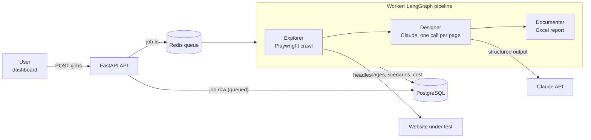
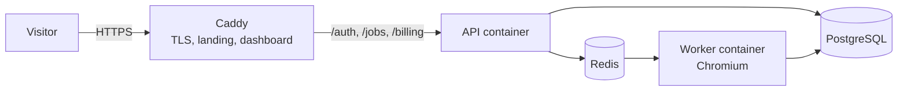

# Tests Wise: AI agents that test-plan any website

**Live product:** [app.tests-wise.com](https://app.tests-wise.com/#how) · **How it works:** [app.tests-wise.com/#how](https://app.tests-wise.com/#how)

Tests Wise is a SaaS product in production. You paste the URL of a website. AI agents explore it,
write a prioritized test plan as an Excel report and, on the Pro plan, run every test in a real
browser and report what passed and what failed. It has paying plans, user accounts, a public
landing page in English and Spanish, and an automated deployment pipeline.

## The problem

Small teams ship websites without a dedicated QA engineer: agencies, freelancers, startups.
Writing a test plan by hand is slow, so it gets skipped, and bugs reach customers.

- A useful test plan for an 8-page site takes a tester several hours: visit every page, list every
  form and flow, write the steps and expected results, decide what matters most.
- Automated test suites need code, selectors and maintenance that small teams do not have time for.
- Generic AI chat tools can write test cases, but only from what you paste into them. They do not
  see the site, so the result misses real fields, real flows and pages behind a login.

## The solution

1. **Paste a URL.** Optionally describe the app in one line, pick English or Spanish, and add a test
   account if the site needs a login.
2. **Agents explore.** A headless browser visits up to 8 pages, or up to 20 if the user prefers to
   choose which pages matter. It records each page's forms, fields, buttons and navigation.
3. **Claude designs the scenarios.** For every page, the model writes test scenarios with steps,
   expected result, priority and category, using what it saw on the page and the app description.
4. **Download the plan.** The result is an Excel workbook a QA team or a client can use directly.
5. **Run the tests (Pro).** A second agent opens the site in a real browser, follows each scenario
   step by step and records pass, fail or blocked, with a reason and a screenshot.

The whole plan takes a few minutes and typically costs cents in model usage per job.

## How it works

- **The API never does heavy work.** It stores the job, queues its id and answers immediately.
  The dashboard polls for progress. The API and the worker share state only through the database,
  so either one can restart without losing a job.
- **The pipeline is a graph.** Exploration, design and reporting are LangGraph nodes. When a step
  has nothing to work with, the graph takes an explicit failure path instead of crashing.
- **The executor agent drives a browser through tools.** On Pro, Claude controls Chromium with six
  tools: navigate, read the page, click, fill, press a key, finish with a verdict.

## Engineering decisions worth discussing

Each decision is written up as an Architecture Decision Record (ADR) in the repository, with the
context, the options and the consequences. These are the ones I would highlight in an interview:

- **No LLM in the crawl.** Exploration is deterministic: a breadth-first crawl in a real browser
  extracts a compact JSON inventory of each page, under 2 KB, never raw HTML. The model's budget
  goes where judgment matters, designing the tests, and the crawl is reproducible and testable.
- **Structured outputs, validated twice.** The model must answer in a JSON schema, and the
  application validates the rules a schema cannot express. An invalid answer gets exactly one
  self-healing retry that includes the validation errors.
- **A cost ledger for every model call.** Each call is recorded with its tokens, model and cost,
  including retries and failures, because those are billed too. Job cost is a sum over that ledger,
  so pricing decisions rest on real data.
- **Guardrails enforced by the tools, not the prompt.** The executor agent cannot leave the site
  under test and cannot click anything that deletes, cancels or transfers, whatever a scenario
  says. Runs only happen on environments the user confirms are for testing. The prompt states the
  rules, and the code enforces them.
- **Text, not screenshots, for the model.** The executor reads the page as text and an inventory
  of elements. That is cheaper, and no customer pixels leave the server. Screenshots are kept only
  as evidence for the user.
- **Login without exposing credentials.** Test-account passwords are encrypted at rest, used for
  one job and deleted when it ends. They never reach the model, the logs or the traces. The login
  itself is deterministic, and handles redirects, two-step forms and sign-in links.
- **A merchant of record for billing.** Selling worldwide from Colombia means taxes in many
  countries. Payments go through Lemon Squeezy, which acts as the legal seller. The application
  only trusts signed webhooks to change a user's plan.

## Security and reliability

- **Accounts.** Passwords are hashed with Argon2id and checked against known breaches. Users must
  verify their email, and login and registration are rate limited.
- **Data isolation.** Every job is scoped to its owner, so another user's job answers "not found".
- **Untrusted input.** Every URL the crawler visits, including links found during the crawl,
  passes an anti-SSRF check. Model output written to Excel is protected against formula injection.
- **Hardened containers.** They run as an unprivileged user with no Linux capabilities. Only the
  reverse proxy is reachable from the internet.
- **HTTPS and headers.** Certificates are automatic, and the site sends HSTS and a strict Content
  Security Policy.
- **Monitoring.** Errors go to Sentry, model calls can be traced in LangSmith, and a health check
  confirms that the database, the queue and a worker are all ready.

## Testing and continuous integration

There are about 290 automated tests. They run without internet access and without paid API calls:
a safety net in the test setup makes it impossible to reach the real model API by accident.

- **Unit and component tests** cover the crawler against local test sites, the model client at
  three mocking levels, billing webhooks, authentication, the Excel report and the health checks.
- **Real-browser tests** run the login logic and the executor tools in Chromium against local
  sites with cookie sessions.
- **An end-to-end integration test** starts PostgreSQL, Redis, the API and the worker as real
  processes and follows a job from creation to the downloaded report.
- **Every pull request runs in GitHub Actions:** backend tests, a check that database migrations
  match the models, the integration test, the frontend build and lint, and validation of the
  deployment scripts, compose files and proxy configuration.

## How it is deployed

The product runs on a single DigitalOcean server with Docker Compose. For this stage that is the
simplest setup that is still safe: one machine to secure, back up and reason about, with a clear
path to split services later.

**Releases are automatic.** Merging a pull request into `main` deploys it:

1. GitHub Actions runs all the checks above.
2. It connects to the server with an SSH key that can do only one thing: deploy a commit.
   The key has no shell access.
3. The server takes a database backup, checks out the commit, rebuilds the containers and runs
   a smoke test. The smoke test checks the database, the migrations, the queue, a live worker,
   the public pages, the API, the payment webhook and the TLS certificate.
4. If the build or the smoke test fails, the server rolls back to the previous version on its own,
   and the pipeline turns red.
5. GitHub repeats the smoke test from outside, through DNS and HTTPS.

A scheduled workflow runs the same smoke test every 30 minutes and emails an alert when production
is unhealthy. A nightly job backs up the database.

## Tech stack

| Area | Tools |
|---|---|
| Backend | Python 3.12, FastAPI, SQLAlchemy 2.0, Alembic, Pydantic |
| AI | Claude via the official Anthropic SDK (structured outputs, tool use, prompt caching), LangGraph, LangSmith |
| Browser automation | Playwright with headless Chromium |
| Data and jobs | PostgreSQL 16, Redis 7, RQ |
| Frontend | React 19, TypeScript, Vite, Tailwind CSS 4 |
| Reports | openpyxl (Excel) |
| Infrastructure | Docker Compose, Caddy, DigitalOcean, GitHub Actions |
| Services | Lemon Squeezy (payments), Resend (email), Sentry (errors) |
| Quality | pytest, oxlint, shellcheck, Dependabot |

## By the numbers

| | |
|---|---|
| Time from first commit to paying plans in production | about 4 weeks |
| Pull requests merged | 50 |
| Automated tests | about 290 |
| Architecture decision records | 10 |
| Database migrations | 7 |
| Application code | about 6,800 lines of Python and 2,800 lines of TypeScript |

## What is next

- A RAG layer so scenarios reuse knowledge from earlier jobs on the same site.
- An MCP server so Claude Desktop and IDEs can call Tests Wise directly.
- A command-line client for CI pipelines.
- Team accounts and usage-based billing beyond the monthly allowance.

---

Try it at [app.tests-wise.com](https://app.tests-wise.com/#how). The free plan needs no credit card.
